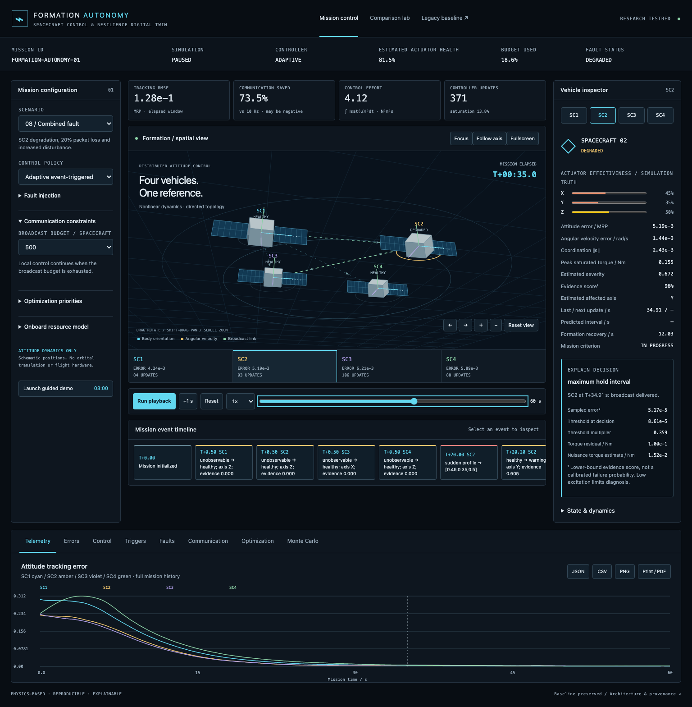
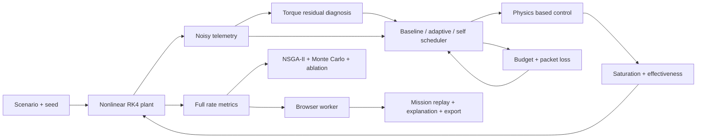
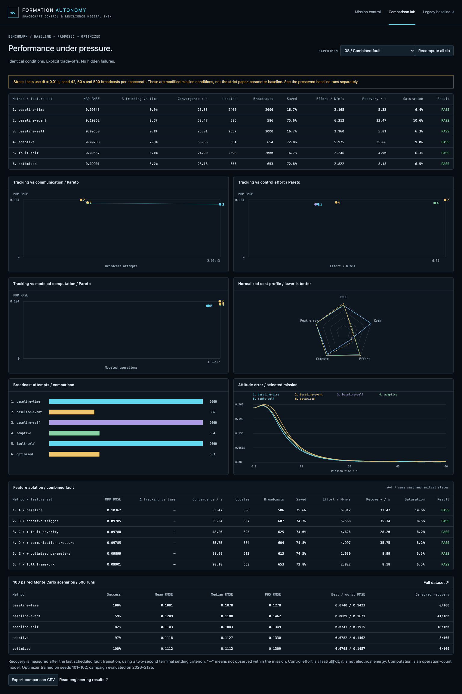

# Autonomous Spacecraft Formation Control and Resilience Digital Twin

**Fault-Aware Adaptive Control, Communication Optimization, and Autonomous Mission Simulation**

A four-spacecraft **attitude-control research testbed** that connects nonlinear physics, residual-based diagnosis, communication-aware scheduling, reproducible optimization and mission replay. The original IEEE-paper implementation is preserved as a reference baseline. This project does not claim flight readiness, safety certification or new invention of event-triggered fault-tolerant control.



## Problem and motivation

A distributed spacecraft controller must coordinate attitude while actuator authority changes, torques saturate and communication is limited. One nominal trajectory cannot establish resilience. Engineers need to inspect fault response, track the cost of each update, reproduce failure cases and understand why a scheduling decision occurred.

## Existing baseline and research gap

The supplied project implements X. Xie, T. Sheng and X. Chen, *Dynamic Event-Triggered and Self-Triggered Fault-Tolerant Attitude Control for Multiple Spacecraft Systems With Uncertainties and Input Saturation*, IEEE TAES 60(3), 2024. [Reference DOI](https://doi.org/10.1109/TAES.2024.3355381).

Its original MATLAB/Simulink files, fourteen figures and documentation remain intact. The original visualization and README are available in [baseline/](baseline/README.md). `baseline/manifest.json` checks 29 original artifacts. The audit found browser/MATLAB numerical differences and an extra factor two in the MATLAB self-trigger denominator relative to printed Equation 26. Strict mode preserves the repository implementation; it is not advertised as a verified exact paper reproduction.

The extension addresses diagnosed severity, explicit fault missions, communication budgets, parameter search, paired robustness testing and traceable telemetry. These are additions relative to the supplied testbed. Literature-wide originality is **not established**. [Novelty analysis](docs/novelty_analysis.md).

## Architecture



One ECMAScript engine serves the browser worker and Node experiments. The new native MATLAB extension is isolated under `simulation/extensions/`. It includes a separate model builder and an independent baseline validation harness. **MATLAB/Simulink execution has not been verified in this environment.** [Full audit and data flow](docs/ARCHITECTURE.md).

## Mathematical model

```
sigma_dot = [(1 - sigma' sigma) I/4 + skew(sigma)/2 + sigma sigma'/2] omega
J omega_dot = -omega × J omega + Gamma sat(u) + drift + rho
s_i = e2_i + r e1_i
u_i = -k1_i s_sample - k2_i alpha Phi_i sign(s_sample)
```

Four rigid bodies, 24 states, diagonal inertia and a directed communication topology. Body torques clip at ±0.2 Nm. The scene's positions are schematic; orientation and angular velocity come from the simulation. No orbital/translational dynamics are implied. [Model and metric definitions](docs/mathematical_model.md).

## Fault model and diagnosis

Healthy, partial/severe degradation, complete single-axis failure, multiple-axis losses, sudden/gradual/intermittent profiles, packet loss, increased disturbance and noisy sensors are configurable. A four-second sliding-window torque regression estimates axis effectiveness using measured angular acceleration and commanded torque. It does not read injected fault truth. A transparent excitation gate and uncertainty-derived **evidence score** replace fictional AI confidence. [Fault model](docs/fault_model.md).

## Adaptive trigger mechanism

The proposed threshold scales the baseline squared-error threshold using coordination/tracking error, estimated fault severity, residual torque, budget use and recent update rate. A maximum hold interval prevents indefinitely stale local control. Optional bounded effectiveness compensation retains the physics-based controller. Fault-aware self scheduling rescales the predicted interval at updates. All changes are empirical; no new stability theorem is claimed. [Exact equations](docs/proposed_method.md).

## Optimization

A seeded NSGA-II-style search evaluates 48 candidate parameter sets on two training missions. Five fixed-normalized costs cover tracking, communication, torque-squared effort, modeled computation and recovery. Original parameters remain available. The weighted selection and nondominated candidates are saved in JSON. Search gains are not assumed to generalize. [Optimization protocol](docs/optimization.md).

## Monte Carlo validation and results

**100 paired randomized environments × five policies = 500 runs**, separate from training. Initial attitude/rates, inertia, effectiveness, disturbances, fault timing/severity, dropout and sensor noise vary. The report retains failures and censored recovery times.

| Method | Terminal success, sampled campaign |
|---|---:|
| Baseline time-driven | 100/100 |
| Baseline event-triggered | 59/100 |
| Baseline self-triggered | 82/100 |
| Adaptive event-triggered | 97/100 |
| Optimized | 100/100 |

Success means every spacecraft remains below the specified MRP/rate tolerances for at least the last two seconds of the 60-second run. These percentages are not operational reliability estimates. Time-driven control remains better on some accuracy measures, and not every ablation improves every cost.


[Complete numerical results and A–J engineering report](docs/RESULTS.md) · [Experiment matrix](docs/experiments.md) · [Monte Carlo protocol](docs/monte_carlo.md)

## Interface and demonstration

- Mission dashboard: camera rotate/zoom/pan, vehicle focus, body axes, reference direction, angular velocity, directed links and orientation trails.
- Inspector: actual versus estimated actuator state, coordination errors, control/saturation, trigger deadlines, residuals and decision evidence.
- Replay timeline: select injection, diagnosis or controller events and inspect their recorded state.
- Analysis: telemetry, errors, control, triggers, faults, communication, optimization and Monte Carlo.
- Comparison lab: six methods, summary metrics, Pareto views, radar/bar/line charts, ablation and campaign statistics.
- Export: run JSON, downsampled telemetry CSV, plot PNG, and printable PDF-ready report. Scientific figures include SVG.
- Three-minute guided demo: 90 simulated seconds at 0.5×. Faults are scripted; detection, recovery and final success are calculated.
- Hardware profiles: clearly labeled **SIMULATED RESOURCE MODEL**, with configurable operation throughput and explicit message-size assumptions.



## Installation and quick start

Requires Node.js ≥20.11; tested with Node 24.17. No external JavaScript packages are needed to run the application or numerical experiments.

```sh
npm start
```

Open [Mission control](http://127.0.0.1:4173/) or [Comparison lab](http://127.0.0.1:4173/comparison.html). Use HTTP rather than file:// so module workers can load. No hosted deployment was performed.

```sh
npm test                         # numerical tests and baseline regression
npm run verify:baseline          # original artifact integrity
node scripts/baseline-runs.mjs   # strict 1 ms repository baseline results
npm run experiments              # optimization + E1–E10 + sensitivity + demo
python3 -m venv .venv
.venv/bin/python -m pip install -r requirements-plots.txt
.venv/bin/python scripts/plot_results.py
node scripts/report-results.mjs
```

For the original MATLAB workflow: from `simulation/`, run `R = sff_run_all`. For the new native harness: add `simulation/extensions` to the MATLAB path and run `R = sff_twin_run(4)`. `sff_build_twin_model` creates a separately named model. Run `sff_validate_baseline` to perform the independent comparison that remains pending. [Complete reproducibility instructions](docs/reproducibility.md).

## Repository map

| Path | Purpose |
|---|---|
| `simulation/` | Unchanged original MATLAB/Simulink baseline |
| `simulation/extensions/` | Native experimental controller, fault plant, metrics and new model builder |
| `baseline/` | Original browser/README, original hashes, frozen port regression |
| `src/` | Shared math, physics, scenarios, diagnosis, policies, research engines |
| `web/` | Worker, mission UI, Canvas 3D projection and comparison charts |
| `scripts/` | Local server, experiment/plot/report runners and browser checks |
| `tests/` | Deterministic numerical and research tests |
| `results/` | Actual simulation records, campaign, plots, screenshots and provenance |
| `docs/` | Model, architecture, protocols, novelty, limitations and results |

## Limitations and future research

This is an empirical local-attitude testbed. Native MATLAB execution remains unverified. No global MRP switching, orbital dynamics, wheel momentum, flight sensor model, real-time hardware measurement, calibrated probabilistic diagnosis or adaptive stability proof is provided. Effort is ∫torque²dt, **not joules**. CPU/RAM/bandwidth estimates are hypothetical resource models. [Full limitations](docs/limitations.md).

Next research priorities: independent MATLAB/Simulink validation; false-alarm/detection-delay calibration; stronger isolated ablations; stability analysis under budget and loss constraints; more realistic actuator/channel models; larger held-out campaigns; embedded/HIL validation.

Original project author: Rishitha C. Original paper authors and their controller contributions remain attributed above.
