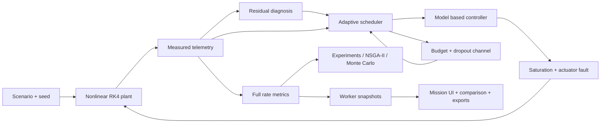

# Architecture and pre-change audit

## Audit, 2026-10-08

All nine original simulation files, both original docs files, all fourteen output figures and their README, and all 81 lines of the original index.html were inspected. The SLX ZIP XML was inspected; its two embedded MATLAB scripts match the external controller and plant sources byte for byte. Figures show attitude convergence and saturated torque histories, but contain no machine-readable trajectories. `baseline/manifest.json` records original SHA-256 hashes. Original MATLAB, SLX, figures and workflow documentation are retained; original landing page and README are copied to `baseline/`.

## Mathematical model

State ordering: x = [sigma_1, omega_1, ..., sigma_4, omega_4], 24 states. G(sigma) = (1-|sigma|²)I/4 + [sigma]x/2 + sigma sigma'/2. sigma_dot = G omega. J omega_dot = -omega cross (J omega) + Gamma sat(u) + drift + rho. Diagonal inertia, effectiveness, sinusoidal disturbances and drift are explicitly given in `simulation/sff_params.m` and `sff_plant_core.m`. Torque clips per axis to ±0.2 Nm. The reference MRP trajectory is analytic; omega_d = inv(G(sigma_d)) sigma_dot_d.

Directed adjacency rows are receivers: A = [0 1 0 0; 1 0 1 0; 1 1 0 0; 1 0 0 0], b = [1,0,0,0]. Coordination uses local current state and the latest broadcast neighbor state: e1_i = b_i(sigma_i-sigma_d) + sum A_ij(sigma_i-sigma_j_broadcast), similarly e2. s=e2+0.6e1.

## Baseline controller and data flow

u = -k1 s_sample - k2 alpha(1+|omega_sample|+|omega_sample|²)sign(s_sample). Gains [12.5,12.5,12.5,25] and [11/6,11/6,11/6,11/3]. Case 1 samples current neighbor states at 10 Hz. Case 2 fires when |s_sample-s|² >= delta|s_sample|²+chi+epsilon; chi uses forward Euler after resetting the sampled error on a trigger. Case 3 schedules with 60 fixed-point iterations. All spacecraft read a broadcast snapshot before that sample's broadcasts are committed.

MATLAB: sff_run_all → sff_params / x0 → SLX (clock → discrete controller → saturation → plant → integrator feedback) → workspace logs → figures. RK4 at 0.001 s over 60 s. Updates counted on [0,60), excluding the terminal sample. Parameters are duplicated in core files; the consistency helper mentioned in sff_params is absent. Changing P alone does not change those hard-coded equations.

## Paper versus implementation

Paper DOI 10.1109/TAES.2024.3355381, supplied PDF, pp. 2923–2928: equations (1–11), topology, numerical parameters and reference align with the sources. Equation (26), visually checked on p.2927, has **no factor 2** in the denominator. MATLAB includes factor 2 (as does Eq.25's lower bound). This is a repository-specific difference, not a verified exact reproduction. Baseline preserves it; no paper trigger counts are used as computed metrics. No theorem transfers automatically to new scheduling or zero-effectiveness cases.

## Original frontend

One self-contained HTML file: Canvas 2D projection of schematic 3D spacecraft; its own JavaScript simulation; no MATLAB connection or imported results. Browser uses 0.005 s, 20 self-trigger iterations, no denominator factor 2, 0.003 s minimum interval, clamped chi, different initial-event counting and intra-step broadcasts. Displayed paper benchmark counts are literals. Therefore it is educational visualization, not the strict MATLAB baseline. Original controls and page remain at `baseline/index.html`.

## Proposed architecture

One dependency-free ECMAScript engine shared by Node experiments and a browser worker. Separate baseline policies and optional extensions. Immutable baseline preset; modified conditions explicitly called stress tests. Layered configurable fault profiles → RK4 plant → sampled noisy telemetry → residual diagnosis → adaptive policy → controller → lossy budgeted broadcast channel. Plant truth is logged but unavailable to diagnosis. Separate seeded random streams make disturbances/noise and losses comparable across policies. Full-rate metrics; downsampled display logs; event decisions retain numerical evidence. NSGA-II operates over bounded parameters, with original parameters retained. Campaigns retain per-run configs/seeds and null for censored convergence/recovery.

The visual positions are schematic, not orbital propagation. Effort ∫|sat(u)|²dt has units N²m²s, not joules. Resource estimates are a simulated operation-cost model, not flight hardware measurements. Native MATLAB extension and validation scripts live separately under simulation/extensions; MATLAB execution is unavailable in this environment.
