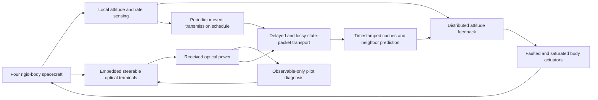

# Project brief

The current evaluation is organized around optical recovery, communication-dependent tracking, and integrated fault tolerance. See [the declared tracking protocol](TRACKING_EXPERIMENT_PLAN.md) and [measured tracking report](../results/tracking/REPORT.md). The static-reference condition described below is retained as a baseline, not the main evidence of communication-dependent coordination.

## Problem

Four spacecraft exchange state information to coordinate attitude. Their optical channels depend on terminal alignment, which changes with spacecraft rotation and terminal faults. A communication interruption changes the information available to the controller; controller behavior in turn changes optical pointing. Treating these as independent simulations misses that feedback.

## Objective

Maintain bounded, accurate attitude coordination while reducing state-message transmissions and recovering optical sessions when local pointing correction is physically capable of restoring them.

## Unified architecture

The spacecraft share a known fixed reference orientation. Neighbor exchange supplies relative-attitude coordination feedback. Independent reference stabilization remains possible during a network partition; communication is not assumed necessary for all stabilization. This distinction matters when interpreting small attitude differences between configurations.

## Research questions supported by the experiments

1. Does observation-based terminal compensation improve availability during a persistent pointing fault?
2. Does event scheduling reduce directed state-message attempts relative to periodic transmission, and at what attitude-error cost?
3. What does bounded neighbor prediction change under delayed and missing messages?
4. Which outages can steering correct, and which remain beyond its physical capability?
5. Does fault clearance cause stale compensation, and does continuing fit validation remove it?

## Deliverables

- One complete source project and one live Simulink model.
- Six physical scenarios and five experiment configurations.
- Deterministic tests, matched-seed trial tables, simulation logs, and plots.
- A mathematical model, explicit assumptions, startup instructions, and validation record.

## What a conference extension would require

The present integration provides a testbed. A potential research extension is a scheduler that explicitly accounts for the uncertainty in neighbor prediction and the predicted risk of losing optical lock. Its novelty would need to lie in a precise rule and supported analysis, not simply the combination of an attitude controller and an optical channel. Current trigger thresholds do not implement that future rule.

## Physical motivation

NASA describes optical terminals with coarse and fine pointing stages, with spacecraft attitude control contributing to coarse pointing. Its CLICK mission description also connects fine-pointing capability to inter-spacecraft optical links. These sources motivate the subsystem architecture; they do not validate this project's numerical parameters or controller.

- NASA, [Communications: State of the Art of Small Spacecraft Technology](https://www.nasa.gov/smallsat-institute/sst-soa/soa-communications/).
- NASA, [CubeSat Laser Infrared CrosslinK (CLICK)](https://www.nasa.gov/smallspacecraft/what-is-click/).
