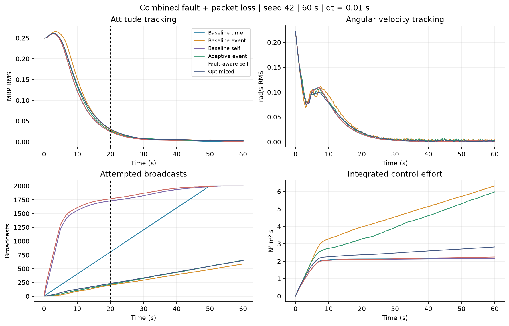
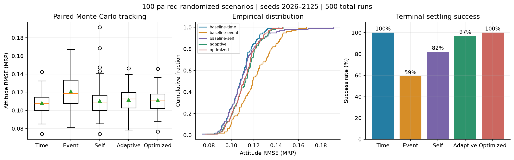
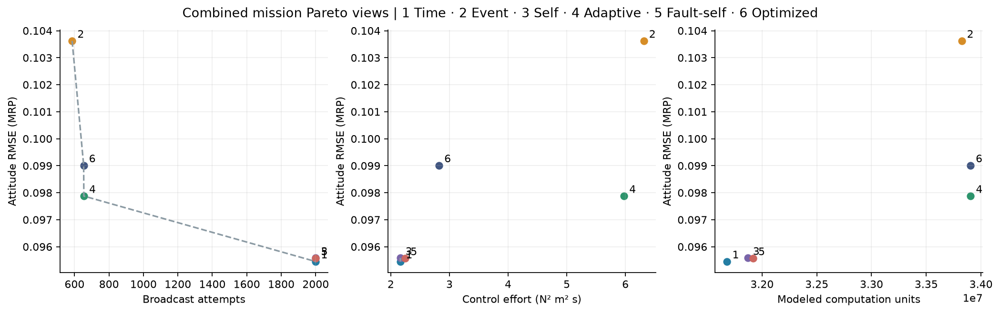
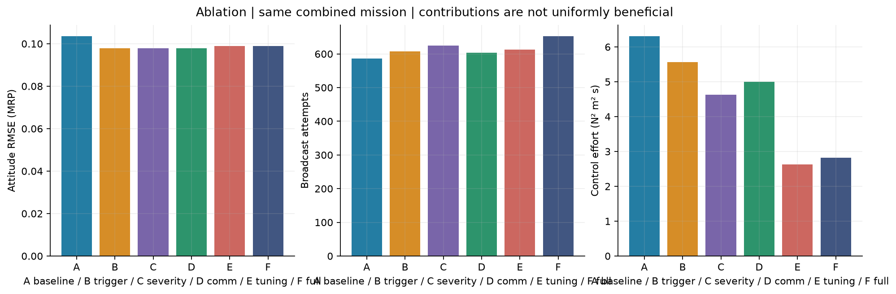
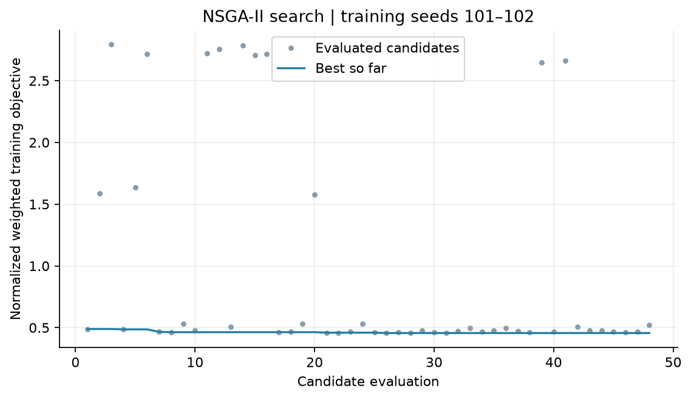

# Results and engineering report

Generated from saved simulation JSON. All numbers below are measured by the new shared engine, not copied from the reference paper. Experiments are finite-horizon numerical evidence, not a stability or flight qualification claim.

## A. What existed before

Four-spacecraft MATLAB/Simulink attitude dynamics, three control policies, fourteen output plots, and a self-contained educational browser visualization. Browser/MATLAB trigger and integration semantics differed; the MATLAB Eq.26 implementation also differs from the PDF. All 29 original artifacts are preserved and hash-checked.

## B. What was added

Shared worker/Node simulation engine; strict locked baseline port; configurable faults; model-based torque residual diagnosis; adaptive scheduling and bounded effectiveness compensation; fault-aware self scheduling; attempted/delivered/dropped/budget-denied communication; NSGA-II; paired Monte Carlo; ablation and dt sensitivity; mission dashboard, comparison page, event replay, exports and a three-minute demonstration. Separate native MATLAB extension and Simulink builder are provided but unexecuted here.

## C. Mathematical changes

Baseline equations remain unchanged. Proposed policies scale the squared-error threshold using coordination/tracking errors, residual severity, nuisance torque and communication pressure; cap hold time; clamp chi; optionally divide commanded torque by bounded estimated effectiveness. Self prediction rescales the repository interval. No inherited theorem is asserted. See [model](mathematical_model.md) and [proposed policy](proposed_method.md).

## D. Algorithmic contribution

An empirically evaluated fault/communication-aware scheduling and diagnosis integration with reproducible experiments. Event-triggered fault-tolerant control itself belongs to the baseline literature. Literature-wide novelty is not established; see [novelty analysis](novelty_analysis.md).

## E. Optimization

NSGA-II: nondominated sorting, crowding, tournament, SBX crossover, bounded Gaussian mutation. 48 evaluated candidates, two training seeds 101, 102, random seed 71. Normalized training objective: original **0.488866**, selected **0.456430** (6.63% lower). This is a training score, not a held-out improvement guarantee. [Algorithm source](https://doi.org/10.1109/4235.996017).

Best parameters:

```json
{
  "r": 0.553328100255431,
  "gainScale": 0.8078576533513103,
  "delta": 0.1792122902308765,
  "epsilon": 0.000027285842119968065,
  "beta1": 6.409193324985646,
  "beta2": 7.906022571932416,
  "gamma": 0.5358694488413669,
  "errorWeight": 2.227070533695018,
  "faultWeight": 4.964165372029189,
  "commWeight": 1.6485844478505272,
  "maxInterval": 0.45183834256044186
}
```

## F. Experimental results

### Strict repository baseline port, 60 s at 1 ms

| Method | Attitude RMSE | ω RMSE | Updates | Attempts | Saved % | Effort N²m²s | Settling s | Recovery s | Success |
|---|---:|---:|---:|---:|---:|---:|---:|---:|---|
| baseline-time | 0.1145 | 0.0548 | 2400 | 2400 | 0.0 | 3.2870 | 29.82 | — | PASS |
| baseline-event | 0.1260 | 0.0563 | 458 | 458 | 80.9 | 7.3434 | 41.62 | — | PASS |
| baseline-self | 0.1146 | 0.0548 | 3202 | 3202 | -33.4 | 3.2918 | 30.25 | — | PASS |

The self-triggered baseline has negative savings. Its 3,202 updates are deliberately retained; no result was tuned to match the paper's table. These are deterministic port outputs pending independent MATLAB validation.

### Combined fault + 20% loss + 3× disturbance, seed 42, 60 s at 10 ms, budget 500

| Method | Attitude RMSE | ω RMSE | Updates | Attempts | Saved % | Effort N²m²s | Settling s | Recovery s | Success |
|---|---:|---:|---:|---:|---:|---:|---:|---:|---|
| baseline-time | 0.0955 | 0.0502 | 2400 | 2000 | 16.7 | 2.1653 | 25.33 | 5.33 | PASS |
| baseline-event | 0.1036 | 0.0515 | 586 | 586 | 75.6 | 6.3125 | 53.47 | 33.47 | PASS |
| baseline-self | 0.0956 | 0.0501 | 2557 | 2000 | 16.7 | 2.1603 | 25.81 | 5.81 | PASS |
| adaptive | 0.0979 | 0.0505 | 654 | 654 | 72.8 | 5.9753 | 55.66 | 35.66 | PASS |
| fault-self | 0.0956 | 0.0501 | 2598 | 2000 | 16.7 | 2.2458 | 24.90 | 4.90 | PASS |
| optimized | 0.0990 | 0.0491 | 653 | 653 | 72.8 | 2.8221 | 28.18 | 8.18 | PASS |

Savings use an unlimited 10 Hz denominator. All six methods receive the same capped mission channel. Baseline time and self reach the budget cap; local updates continue. Read accuracy, effort, budget and recovery together.

### Paired Monte Carlo, 100 scenarios and 500 runs

| Policy | Success | Mean RMSE | Median RMSE | P95 RMSE | Best RMSE | Worst RMSE | Recovery censored |
|---|---:|---:|---:|---:|---:|---:|---:|
| baseline-time | 100% | 0.1081 | 0.1078 | 0.1278 | 0.0740 | 0.1423 | 0/100 |
| baseline-event | 59% | 0.1209 | 0.1188 | 0.1462 | 0.0809 | 0.1671 | 41/100 |
| baseline-self | 82% | 0.1103 | 0.1083 | 0.1349 | 0.0741 | 0.1915 | 18/100 |
| adaptive | 97% | 0.1118 | 0.1127 | 0.1330 | 0.0782 | 0.1462 | 3/100 |
| optimized | 100% | 0.1112 | 0.1112 | 0.1309 | 0.0768 | 0.1457 | 0/100 |

The optimized and time-driven policies both pass all 100 sampled environments. This does not establish 100% operational reliability. Adaptive scheduling improves success relative to event-triggering in this sample but does not dominate time-driven tracking. Distribution assumptions and censoring are documented in [Monte Carlo protocol](monte_carlo.md).

### Ablation

| Method | Attitude RMSE | ω RMSE | Updates | Attempts | Saved % | Effort N²m²s | Settling s | Recovery s | Success |
|---|---:|---:|---:|---:|---:|---:|---:|---:|---|
| baseline-event | 0.1036 | 0.0515 | 586 | 586 | 75.6 | 6.3125 | 53.47 | 33.47 | PASS |
| adaptive | 0.0979 | 0.0506 | 607 | 607 | 74.7 | 5.5678 | 55.34 | 35.34 | PASS |
| adaptive | 0.0979 | 0.0506 | 625 | 625 | 74.0 | 4.6262 | 48.20 | 28.20 | PASS |
| adaptive | 0.0978 | 0.0506 | 604 | 604 | 74.8 | 4.9965 | 55.75 | 35.75 | PASS |
| optimized | 0.0990 | 0.0492 | 613 | 613 | 74.5 | 2.6302 | 28.99 | 8.99 | PASS |
| optimized | 0.0990 | 0.0491 | 653 | 653 | 72.8 | 2.8221 | 28.18 | 8.18 | PASS |

Fault severity, communication pressure, tuning and compensation do not uniformly improve every cost. In this mission full compensation adds broadcasts and effort relative to E, while improving recovery modestly. B/C/D are package additions, not perfectly isolated causal interventions.

### Step sensitivity

| Method | dt s | RMSE | Attempts | Success |
|---|---:|---:|---:|---|
| baseline-event | 0.01 | 0.103622 | 586 | true |
| baseline-event | 0.005 | 0.103692 | 575 | true |
| baseline-event | 0.001 | 0.103833 | 567 | true |
| adaptive | 0.01 | 0.097876 | 654 | true |
| adaptive | 0.005 | 0.097755 | 635 | true |
| adaptive | 0.001 | 0.097798 | 634 | true |
| optimized | 0.01 | 0.099010 | 653 | true |
| optimized | 0.005 | 0.098915 | 660 | true |
| optimized | 0.001 | 0.098615 | 664 | true |

Stochastic sample paths change with dt. This is sensitivity evidence, not a pure deterministic convergence study.

### Figures







### Full deterministic matrix

#### nominal

| Method | Attitude RMSE | ω RMSE | Updates | Attempts | Saved % | Effort N²m²s | Settling s | Recovery s | Success |
|---|---:|---:|---:|---:|---:|---:|---:|---:|---|
| baseline-time | 0.0954 | 0.0502 | 2400 | 2000 | 16.7 | 2.1386 | 25.25 | — | PASS |
| baseline-event | 0.1036 | 0.0515 | 678 | 678 | 71.8 | 6.4960 | 39.57 | — | PASS |
| baseline-self | 0.0955 | 0.0501 | 2526 | 2000 | 16.7 | 2.1578 | 25.39 | — | PASS |
| adaptive | 0.0981 | 0.0506 | 676 | 676 | 71.8 | 5.5844 | 56.14 | — | PASS |
| fault-self | 0.0956 | 0.0501 | 2544 | 1998 | 16.8 | 2.1684 | 25.11 | — | PASS |
| optimized | 0.0988 | 0.0492 | 657 | 657 | 72.6 | 2.6635 | 29.05 | — | PASS |

#### degradation

| Method | Attitude RMSE | ω RMSE | Updates | Attempts | Saved % | Effort N²m²s | Settling s | Recovery s | Success |
|---|---:|---:|---:|---:|---:|---:|---:|---:|---|
| baseline-time | 0.0954 | 0.0502 | 2400 | 2000 | 16.7 | 2.1390 | 25.28 | 0.00 | PASS |
| baseline-event | 0.1036 | 0.0515 | 637 | 637 | 73.5 | 6.3590 | 52.51 | 22.51 | PASS |
| baseline-self | 0.0955 | 0.0501 | 2499 | 2000 | 16.7 | 2.1533 | 25.03 | 0.00 | PASS |
| adaptive | 0.0980 | 0.0506 | 690 | 690 | 71.3 | 5.7904 | 55.43 | 25.43 | PASS |
| fault-self | 0.0956 | 0.0501 | 2562 | 2000 | 16.7 | 2.1769 | 24.76 | 0.00 | PASS |
| optimized | 0.0988 | 0.0492 | 663 | 663 | 72.4 | 2.6943 | 29.33 | 0.00 | PASS |

#### failure

| Method | Attitude RMSE | ω RMSE | Updates | Attempts | Saved % | Effort N²m²s | Settling s | Recovery s | Success |
|---|---:|---:|---:|---:|---:|---:|---:|---:|---|
| baseline-time | 0.0954 | 0.0502 | 2400 | 2000 | 16.7 | 2.2092 | 25.68 | 5.68 | PASS |
| baseline-event | 0.1037 | 0.0516 | 611 | 611 | 74.5 | 6.6558 | — | — | FAIL |
| baseline-self | 0.0956 | 0.0502 | 2811 | 2000 | 16.7 | 2.3207 | 26.47 | 6.47 | PASS |
| adaptive | 0.0996 | 0.0508 | 696 | 696 | 71.0 | 7.3631 | — | — | FAIL |
| fault-self | 0.0956 | 0.0501 | 2853 | 2000 | 16.7 | 2.7962 | 25.83 | 5.83 | PASS |
| optimized | 0.0993 | 0.0493 | 657 | 657 | 72.6 | 3.9907 | — | — | FAIL |

#### multiple

| Method | Attitude RMSE | ω RMSE | Updates | Attempts | Saved % | Effort N²m²s | Settling s | Recovery s | Success |
|---|---:|---:|---:|---:|---:|---:|---:|---:|---|
| baseline-time | 0.0954 | 0.0502 | 2400 | 2000 | 16.7 | 2.1413 | 25.25 | 0.00 | PASS |
| baseline-event | 0.1036 | 0.0515 | 573 | 573 | 76.1 | 6.3189 | 43.87 | 8.87 | PASS |
| baseline-self | 0.0955 | 0.0501 | 2495 | 1999 | 16.7 | 2.1508 | 25.48 | 0.00 | PASS |
| adaptive | 0.0980 | 0.0506 | 673 | 673 | 72.0 | 6.3275 | 53.20 | 18.20 | PASS |
| fault-self | 0.0956 | 0.0501 | 2573 | 2000 | 16.7 | 2.2080 | 25.55 | 0.00 | PASS |
| optimized | 0.0988 | 0.0492 | 672 | 672 | 72.0 | 2.7904 | 28.41 | 0.00 | PASS |

#### dropout

| Method | Attitude RMSE | ω RMSE | Updates | Attempts | Saved % | Effort N²m²s | Settling s | Recovery s | Success |
|---|---:|---:|---:|---:|---:|---:|---:|---:|---|
| baseline-time | 0.0954 | 0.0502 | 2400 | 2000 | 16.7 | 2.1384 | 25.26 | 5.26 | PASS |
| baseline-event | 0.1036 | 0.0516 | 611 | 611 | 74.5 | 6.2391 | 55.88 | 35.88 | PASS |
| baseline-self | 0.0955 | 0.0501 | 2481 | 1999 | 16.7 | 2.1511 | 25.13 | 5.13 | PASS |
| adaptive | 0.0981 | 0.0505 | 634 | 634 | 73.6 | 5.8532 | 56.81 | 36.81 | PASS |
| fault-self | 0.0956 | 0.0501 | 2470 | 1981 | 17.5 | 2.1782 | 25.37 | 5.37 | PASS |
| optimized | 0.0989 | 0.0492 | 619 | 619 | 74.2 | 2.7275 | 27.00 | 7.00 | PASS |

#### disturbance

| Method | Attitude RMSE | ω RMSE | Updates | Attempts | Saved % | Effort N²m²s | Settling s | Recovery s | Success |
|---|---:|---:|---:|---:|---:|---:|---:|---:|---|
| baseline-time | 0.0955 | 0.0502 | 2400 | 2000 | 16.7 | 2.2538 | 25.42 | 5.42 | PASS |
| baseline-event | 0.1038 | 0.0515 | 636 | 636 | 73.5 | 6.4390 | — | — | FAIL |
| baseline-self | 0.0958 | 0.0501 | 2867 | 2000 | 16.7 | 2.2371 | 25.38 | 5.38 | PASS |
| adaptive | 0.0981 | 0.0506 | 693 | 693 | 71.1 | 4.6423 | 45.43 | 25.43 | PASS |
| fault-self | 0.0957 | 0.0501 | 2892 | 2000 | 16.7 | 2.3585 | 25.57 | 5.57 | PASS |
| optimized | 0.0990 | 0.0492 | 788 | 788 | 67.2 | 2.7515 | 28.37 | 8.37 | PASS |

#### noise

| Method | Attitude RMSE | ω RMSE | Updates | Attempts | Saved % | Effort N²m²s | Settling s | Recovery s | Success |
|---|---:|---:|---:|---:|---:|---:|---:|---:|---|
| baseline-time | 0.0954 | 0.0502 | 2400 | 2000 | 16.7 | 2.1624 | 25.34 | — | PASS |
| baseline-event | 0.1039 | 0.0513 | 680 | 680 | 71.7 | 6.4130 | — | — | FAIL |
| baseline-self | 0.0956 | 0.0501 | 2589 | 2000 | 16.7 | 2.1723 | 25.38 | — | PASS |
| adaptive | 0.0982 | 0.0510 | 695 | 695 | 71.0 | 4.1287 | 28.18 | — | PASS |
| fault-self | 0.0962 | 0.0502 | 3059 | 2000 | 16.7 | 2.1416 | 34.95 | — | PASS |
| optimized | 0.0982 | 0.0490 | 740 | 740 | 69.2 | 2.4506 | 27.16 | — | PASS |

#### combined

| Method | Attitude RMSE | ω RMSE | Updates | Attempts | Saved % | Effort N²m²s | Settling s | Recovery s | Success |
|---|---:|---:|---:|---:|---:|---:|---:|---:|---|
| baseline-time | 0.0955 | 0.0502 | 2400 | 2000 | 16.7 | 2.1653 | 25.33 | 5.33 | PASS |
| baseline-event | 0.1036 | 0.0515 | 586 | 586 | 75.6 | 6.3125 | 53.47 | 33.47 | PASS |
| baseline-self | 0.0956 | 0.0501 | 2557 | 2000 | 16.7 | 2.1603 | 25.81 | 5.81 | PASS |
| adaptive | 0.0979 | 0.0505 | 654 | 654 | 72.8 | 5.9753 | 55.66 | 35.66 | PASS |
| fault-self | 0.0956 | 0.0501 | 2598 | 2000 | 16.7 | 2.2458 | 24.90 | 4.90 | PASS |
| optimized | 0.0990 | 0.0491 | 653 | 653 | 72.8 | 2.8221 | 28.18 | 8.18 | PASS |

## G. UI/UX changes

Mission-control layout, 3D projected schematic vehicles with true simulated orientation, mouse/keyboard camera controls, selectable vehicle telemetry, real diagnosis evidence, update explanations, replay timeline, eight analysis tabs, loss/budget accounting, hardware cost profiles, comparison charts and JSON/CSV/PNG/print exports. The demo schedules faults but never schedules fictional detection or success. Scientific plots also export to SVG.

## H. Testing

Numerical suite: 24 tests passed at report generation, including three full 60 s baseline regressions, kinematics, plant, saturation, directed coordination, controller, self scheduling, adaptive response, fault profiles, excited-axis diagnosis, determinism, budget/dropout semantics, objective, nondominated sorting, seeded optimizer and censoring statistics. Original artifact integrity: 29/29 hashes preserved. Browser desktop/mobile smoke checks reported no JavaScript errors and no mobile page overflow. MATLAB/Simulink execution and HIL were unavailable and are not counted as passed.

## I. Limitations

No translational/orbital formation, global MRP chart handling, formal adaptive stability proof, calibrated probabilistic diagnosis, characterized hardware costs, or operational reliability inference. Optimization is small and training-scenario dependent. MATLAB extension and cross-runtime baseline parity remain unverified. See [complete limitations](limitations.md).

## J. Recommended future research

Independently validate with MATLAB/Simulink; calibrate detection delays and false alarms under sensor/inertia uncertainty; derive stability conditions with saturation and packet loss; model wheels and link delays; isolate adaptation channels; expand to 500 held-out environments per method; test real embedded execution and compare against additional published schedulers.
