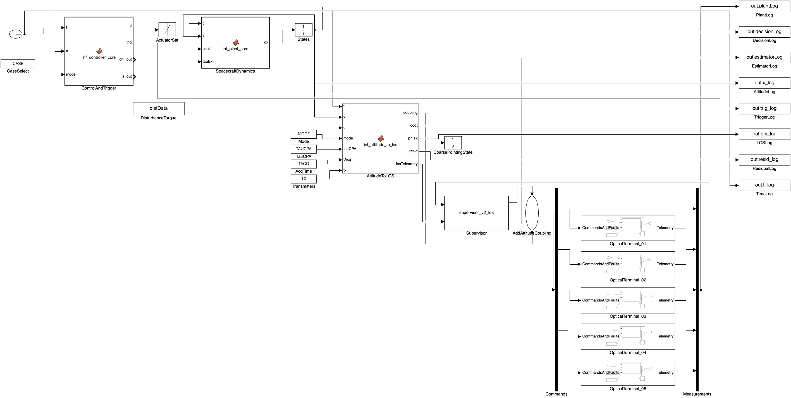
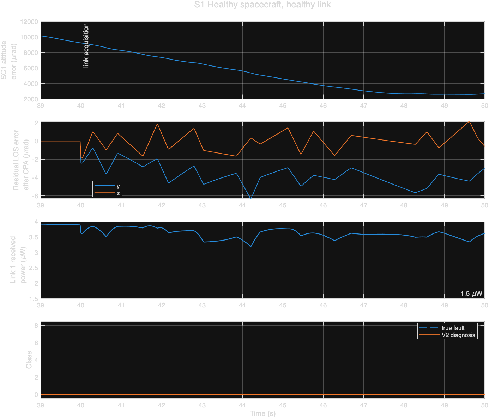
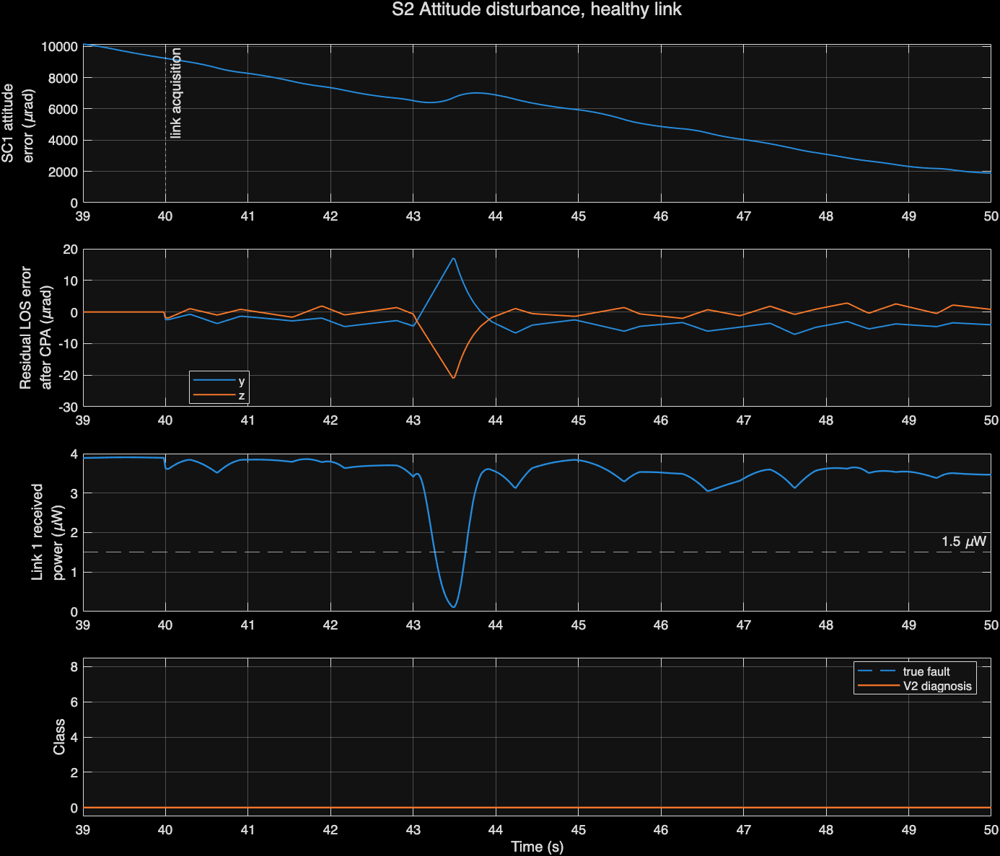
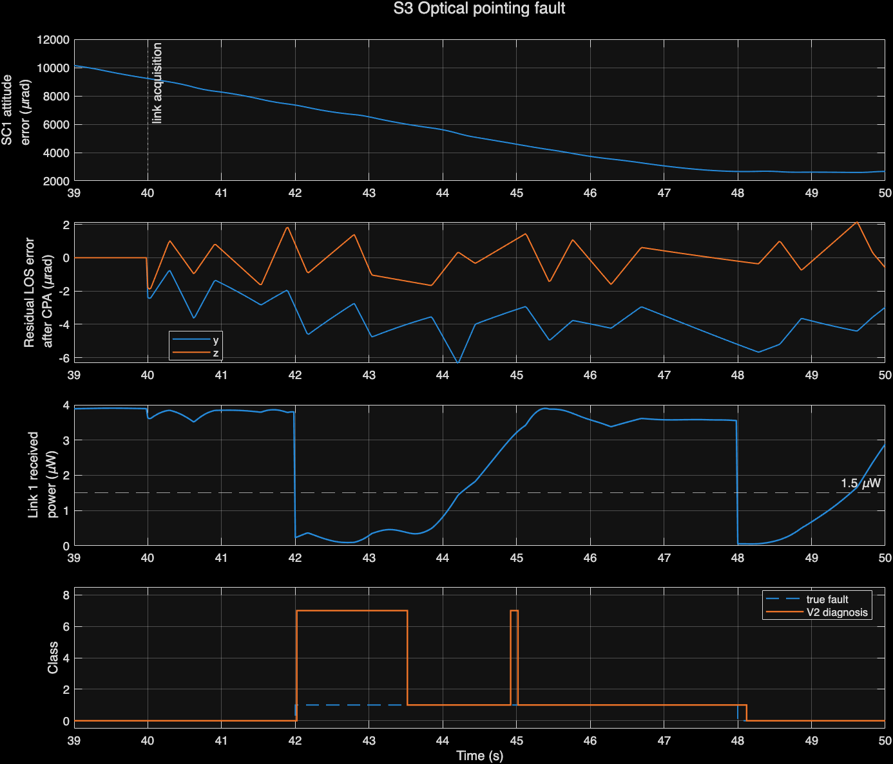
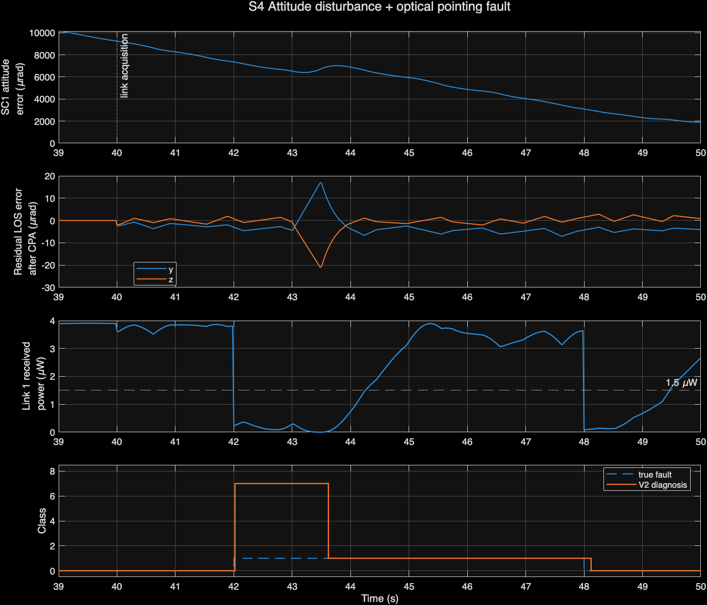
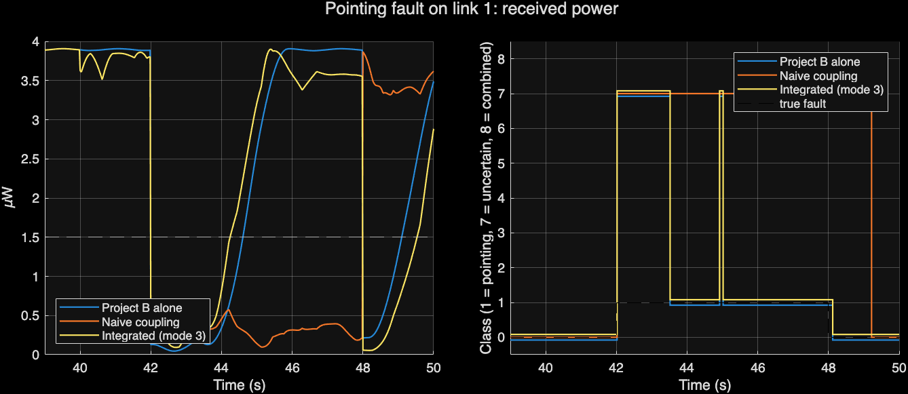

# Integrated formation attitude control and laser link recovery

One Simulink model of a four-spacecraft formation linked by lasers. It has three layers that share one clock and one state:

1. **Attitude control.** Each spacecraft runs a distributed, fault-tolerant sliding-mode attitude controller. Its updates are time-driven, event-triggered or self-triggered (Xie, Sheng and Chen, IEEE TAES 2024).
2. **Pointing.** Each laser terminal sits on its spacecraft's body, so the spacecraft's attitude error tilts the beam. A coarse-pointing stage follows the attitude and leaves a small residual.
3. **Link supervision.** The V2 supervisor diagnoses that residual together with any terminal faults: it probes, corrects, rolls back, verifies, and reroutes traffic over the network.

**Where the code comes from.** The attitude layer is the formation attitude-control code, copied unchanged into `projectA/` (source commit in `projectA/SOURCE_COMMIT.txt`). The link layer uses this repository's `matlab/`, `simulink/` and `revisions/v2/` code. The new code is the pointing layer (`int_attitude_to_los.m`) and a three-line extension of the V2 supervisor that takes the attitude residual as telemetry.

MATLAB R2026a with Simulink runs everything below. Every number in this file comes from an executed run.

## Run it

```matlab
cd integration
int_run_all          % baselines -> build -> validate -> scenarios -> tests (about 2 min on this Mac)
```

The steps can also be run one at a time: `run_baselines`, `int_setup; int_build_model`, `int_validate`, `int_scenarios`, `int_tests`. To run a single case: `r = int_run('scenario','pointing','mode',3,'attCase',3)`.

## Block diagram



```
Attitude layer (1 kHz, ode4)                           Pointing layer                          Link layer (V2 supervisor, 20 ms)
Clock, CASE -> ControlAndTrigger (sff_controller_core)                                          Supervisor (supervisor_v2_los, 20 ms)
            -> ActuatorSat (+/-0.2 N*m)                                                            | commands u (11 per link)
            -> SpacecraftDynamics (sff_plant_core + optional disturbance torque)                   v
            -> States x (24)  ----------------------->  AttitudeToLOS  -- d -->  ( + ) into u(9:10) of each link
                                                        + coarse-pointing state c        |
                                                        -- d (telemetry, mode 3) ------->  Supervisor input 2
                                                                                          OpticalTerminal_01..05 (terminal_kernel)
                                                                                          -> Measurements -> Supervisor input 1
```

## Equations connecting attitude to optical pointing

For each optical link j, the transmitter is spacecraft i (the first node of the edge). Link 1 runs from SC1 to SC2.

1. **Attitude error, as the attitude controller defines it:** σₑ = σᵢ − σ_d(t). These are MRPs, with σ_d(t) taken from `sff_ref`.
2. **MRP to rotation vector, in rad:** φ = 4·atan(|σₑ|)·σₑ/|σₑ|. For small errors this is about 4σₑ.
3. **Projection onto the terminal:** the boresight lies along body +x, so the two transverse LOS axes are φ_LOS = [φ_y, φ_z]. These match the terminal's two axes.
4. **Coarse pointing:** a minimal first-order coarse pointing assembly (CPA) follows the measured attitude: ċ = (φ_LOS − c)/τ_CPA, with τ_CPA = 5 ms. Its tracking residual is d = φ_LOS − c.
5. **Laser terminal plant:** the terminal's optical error becomes θ + δ_fault + d. Here d is added to the existing optical-offset input u(9:10), so `terminal_kernel` is unchanged.
6. **Mode 3 telemetry:** d is known onboard (attitude estimate minus coarse-stage position). It goes to the supervisor, which uses it only in its optical power model: P = P₀·g·exp(−2|q + d + δ|²/α²). This affects the fit, the stale-fit check and the residual test. Nothing changes in its rate integration, its sensor-bias test or its commands.

Units: the attitude layer uses rad, rad/s and N·m; the link layer uses rad and W. All layers share one clock.

**How conflicting commands are avoided:**

- The attitude controller commands only spacecraft body torque.
- The link supervisor commands only the terminal's fine-pointing reference.
- The interface adds its output into its own slots and never overwrites either command.
- The fine gimbal's reaction torque on the spacecraft is up to 2×10⁻⁶ N·m. That's 0.1% of the 2×10⁻³ N·m disturbances the attitude model already includes, so the coupling is one-way: attitude affects optics.

**Timeline of one run:**

| Time | What happens |
|---|---|
| 0–40 s | Formation converges (the paper says "within 40 s"). Terminals run uncoupled. |
| 40 s | Link acquisition: the coupling switches on. |
| 41–50 s | Link scoring window, 450 samples. |
| 42–48 s | Optical terminal fault (`fault_input`), shifted by 40 s. |
| 43.0–43.5 s | Attitude disturbance in S2 and S4: 0.05 N·m on SC1's y and z axes. |

**Modes:**

| Mode | Meaning |
|---|---|
| 0 | Interface off, both projects independent |
| 1 | Raw coupling, no coarse pointing |
| 2 | Coarse pointing, but the supervisor isn't told d |
| 3 | Coarse pointing, and d sent to the supervisor (the integrated system) |

## Results

Attitude control runs Case 3 (self-triggered) unless stated otherwise, with 4 satellites and seed 101. Diagnosis and outage figures are for link 1, scored over 41–50 s with the original link `compute_metrics`.

| Run | A case | Mode | LOS residual RMS / max (µrad) | Detection | Exact isolation | False alarms | Link 1 down (s) | No route (s) | Recovered | V2 labels | A triggers |
|---|---|---|---|---|---|---|---|---|---|---|---|
| **S1** healthy | 3 | 3 | 4.1 / 6.3 | 100% | n/a | 0% | 0.00 | 0.00 | n/a | 0 | 3084 |
| **S2** attitude disturbance | 3 | 3 | 6.2 / 27.0 | 100% | n/a | 0% | 0.36 | 0.36 | yes | 0 | 3103 |
| **S3** optical pointing fault | 3 | 3 | 4.1 / 6.3 | 98.4% | 73.0% | 4.0% | 3.80 | 0.00 | yes | 0, 1, 7 | 3084 |
| **S4** disturbance + pointing fault | 3 | 3 | 6.2 / 27.0 | 98.4% | 73.0% | 4.0% | 3.74 | 0.36 | yes | 0, 1, 7 | 3103 |
| Attitude coupling off, pointing fault | 3 | 0 | 0 | 98.4% | 73.0% | 4.0% | 3.72 | 0.00 | yes | 0, 1, 7 | 3084 |
| Attitude coupling off, healthy | 3 | 0 | 0 | 100% | n/a | 0% | 0.00 | 0.00 | n/a | 0 | 3084 |
| Supervisor not told d, pointing fault | 3 | 2 | 4.1 / 6.3 | 86.2% | **0%** | 40.7% | 6.00 | 0.00 | **no** | 0, 7 | 3084 |
| Supervisor not told d, disturbance | 3 | 2 | 6.2 / 27.0 | 77.6% | n/a | 22.4% | 0.38 | 0.38 | yes | 0, 7 | 3103 |
| No coarse pointing, healthy | 3 | 1 | 2915 / 5299 | 0% | n/a | 100% | 9.00 | 9.00 | no | 7 | 3084 |
| S1 with A Case 1 (time-driven) | 1 | 3 | 1.7 / 2.0 | 100% | n/a | 0% | 0.00 | 0.00 | n/a | 0 | 2004 |
| S1 with A Case 2 (event-triggered) | 2 | 3 | 12.2 / 26.0 | 100% | n/a | 0% | 2.60 | 2.58 | yes | 0 | 373 |
| S3 with A Case 2 (event-triggered) | 2 | 3 | 12.2 / 26.0 | 94.4% | 70.3% | 16.0% | 4.32 | 2.82 | yes | 0, 1, 7 | 373 |

Labels: 0 = healthy, 1 = pointing fault, 7 = uncertain. The full table is in `results/scenarios.csv`.

**What the integration shows:**

1. **The raw attitude error is far too large for the laser.** The attitude controller's steady-state error projects to about 2,900 µrad RMS on the LOS, against a 20 µrad beam. Without coarse pointing the link never closes. That's why a coarse-pointing stage is part of the minimum interface.
2. **The supervisor has to know the attitude residual.** With only a 4 µrad residual, a supervisor that doesn't know about it can't isolate the pointing fault (73% → 0%), never recovers the link, and raises false alarms on 41% of healthy samples. Given the residual as telemetry, V2 matches its standalone performance exactly: 73.0% isolation and recovery.
3. **Attitude problems are common-mode.** A disturbance on SC1 degrades every link SC1 transmits on, at the same time. Rerouting can't help, so the network loses its route for 0.36 s. V2 correctly reports no terminal fault, with no false alarms.
4. **The attitude triggering choice affects the laser link.** Case 2 uses 88% fewer attitude updates than Case 3 (373 vs 3084), but its 12 µrad residual causes 2.6 s of link outage with no optical fault at all. Case 1 gives the smallest residual, 1.7 µrad.







## Tests: commands and actual outcomes

**`run_baselines`**, the original projects unmodified:

- Attitude-only Simulink model, 0–60 s: trigger counts are Case 1 600×4, Case 2 [111 127 122 98] and Case 3 [598 609 620 1375]. Steady-state max |σₑ| is 2.89e-3, 5.40e-3 and 2.89e-3.
- Link-only Simulink model: n4 pointing V2 seed 101 equals the saved record on all checked metrics (98.44%, 76.33%, 4.00%, 3.82 s, recovered).

**`int_validate`**, the integrated model with the interface off (mode 0):

- **Attitude layer:** steady-state accuracy is identical for all cases, and trigger counts are identical for Cases 2 and 3. Case 1 gives 601 vs 600 because this log includes the t = 60 s sample.
- **Link layer, sensor fault:** all six metrics are identical.
- **Link layer, pointing and power faults:** detection, false alarms, outage and recovery match. Exact isolation is 0.730 vs 0.763 (pointing) and 0.747 vs 0.763 (power). The cause is the solver: the whole model runs at the attitude loop's 1 ms ode4 instead of the link-only model's 20 ms ode3.

**`int_tests`**: 15 of 15 checks passed.

- Signal dimensions and sample times.
- LOS equals the MRP-to-rotation-vector projection, in rad.
- Both controllers active: attitude control triggers on all four spacecraft, and the V2 supervisor probes, corrects and rolls back.
- The attitude disturbance raises the LOS residual (6.3 → 27.0 µrad) and causes an outage only when coupled.
- No fault truth or schedule reaches the decision step or the interface. This was checked in the code, and the interface output is identical with and without an optical fault.
- Network throughput matches routes recomputed from link availability, and network outage occurs only while all of SC1's links are down.
- Both baselines are reproduced.
- Mode 3 keeps the standalone V2 diagnosis under coupling.

One check initially failed. B's decision log is written one 20 ms sample after the measurements it uses, because the S-function runs Outputs before Update. The test now compares log row k+1 with measurement row k, and passes with 0 mismatches.

## Files added

| File | Purpose |
|---|---|
| `int_attitude_to_los.m` | The interface: attitude error → LOS error, the coarse-pointing residual and the mode-3 telemetry |
| `int_plant_core.m` | Calls the unchanged `sff_plant_core` and adds an optional external disturbance torque |
| `supervisor_v2_los.m`, `v2_decision_step_los.m` | Copies of B's V2 supervisor with a second input, d. Three lines differ (see the diff in their headers); with d = 0 they behave identically |
| `int_build_model.m` → `IntegratedFormationOptical.slx` | Builds the integrated Simulink model |
| `int_config.m`, `int_setup.m`, `int_run.m` | One scenario: configure, simulate and score with both projects' original metrics |
| `run_baselines.m`, `int_validate.m`, `int_scenarios.m`, `int_tests.m`, `int_run_all.m` | Baselines, validation, scenarios, tests and the full pipeline |
| `results/` | `baselines.mat`, `validation.mat`, `scenarios.csv/.mat`, `tests.mat` and the figures |

## Faculty presentation script (about 3 minutes)

1. "Our system is a formation of four spacecraft that talk to each other by laser. Each spacecraft holds its attitude with a fault-tolerant sliding-mode controller that only updates when it needs to. Each laser terminal is mounted on its spacecraft, so the spacecraft's attitude decides where the beam points, and a link supervisor works out what is wrong when a link fails and repairs it."
2. "Attitude reaches the laser through one equation. We convert the attitude error from MRPs to a rotation vector and project it onto the terminal's two pointing axes. That tilt is added to the beam. The three layers never fight: attitude control commands body torque, coarse pointing follows the attitude, and the link supervisor commands only the fine-pointing reference."
3. "The first result is about scale. A's steady-state attitude error is about 2,900 microradians, while the beam is 20 microradians wide. Without a coarse pointing stage the link never closes, so we added the simplest one possible: a first-order stage with a 5 ms time constant. That leaves about 4 microradians of residual."
4. "The second result surprised us. Even 4 microradians that the optical supervisor doesn't know about breaks its diagnosis. Isolation of a pointing fault drops from 73% to zero and the link is never recovered. That residual is known onboard, so we pass it to the supervisor's power model as telemetry. That restores exactly the standalone performance: 73% isolation and full recovery."
5. "The third result is a genuine coupled effect. A torque disturbance on one spacecraft takes down all of its links at once, so rerouting cannot help and the network loses its route for 0.36 seconds. The supervisor correctly reports that no terminal is faulty."
6. "Finally, the attitude triggering choice matters for communication. Event-triggered control saves 88% of attitude updates, but its larger jitter causes 2.6 seconds of link outage with no optical fault at all."
7. "Everything is reproducible with one command. With the attitude coupling switched off, the attitude-only and link-only behaviour is reproduced exactly as before. All 15 integration checks pass. These are simulation results with the simplifications we list."

## Limitations

- **One-way coupling.** Gimbal reaction torque on the spacecraft is neglected; it's about 0.1% of the modelled disturbances.
- **Transmitter only.** Only the transmitter's attitude enters each link. Receiver attitude is neglected, which assumes the receiver's field of view is much wider than the beam.
- **Assumed boresight.** It's taken to lie along body +x for every link. Real terminals have their own mounting geometry and line-of-sight directions.
- **Minimal coarse pointing.** The stage is a first-order follower with τ = 5 ms and perfect attitude knowledge, since the attitude model has no sensor noise. It has no range or rate limits, and no hardware model.
- **Time convention.** The attitude error σ − σ_d is a component-wise difference, not a true MRP composition. It's accurate for these small errors.
- **Solver.** The whole model runs at the attitude loop's 1 ms ode4. Exact isolation therefore differs slightly from the earlier link-only runs at 20 ms ode3 (0.730 vs 0.763 for pointing), with every other checked metric equal.
- **Supervisor copy.** The mode-3 supervisor is a three-line copy of V2 that uses the d telemetry. B's original files are untouched.
- **Narrow coverage.** One seed (101), four satellites, one disturbance profile, and only link 1 faulted. There's no orbital motion and traffic is a steady flow. No Monte Carlo sweep has been run yet.
- **Nothing blocked.** MATLAB R2026a and Simulink were available and every listed test was executed.
