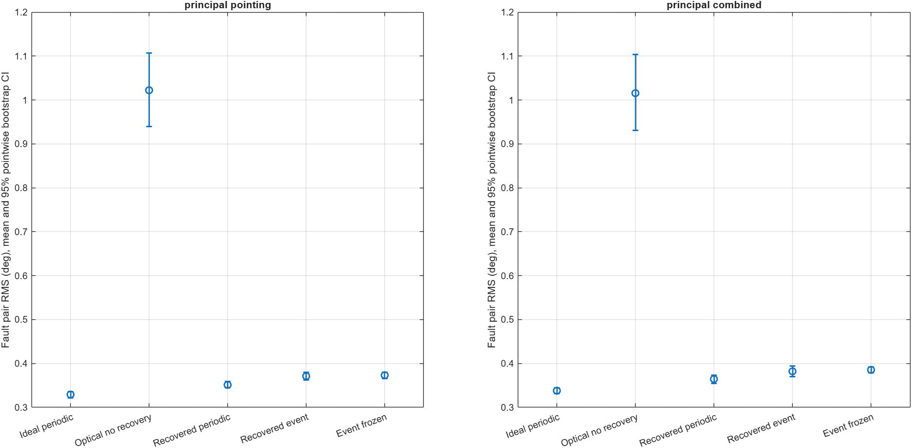
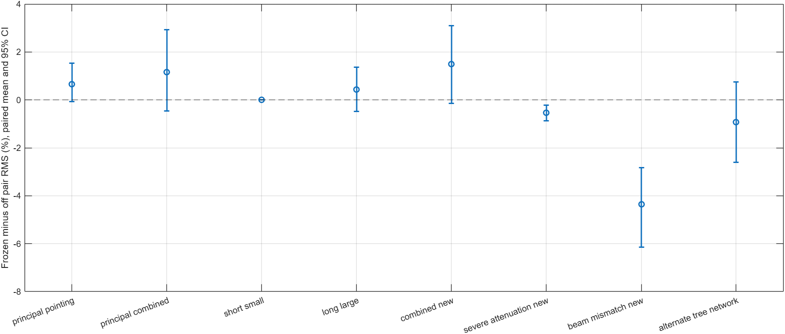

# Held-out evaluation: frozen management rule and paired confidence intervals

440 new runs use 20 independent seeds (101–120), with paired conditions across compared configurations. Initial attitudes/rates, reference phase, disturbance phases/amplitudes, and channel realizations vary. These runs were not used to choose the rule. The previous development tables and adverse outcomes are retained unchanged.

The protocol and source were locally locked before evaluation, with hashes verified after completion. This is a local reproducibility record, not a public preregistration or proof of algorithmic novelty.

## Frozen rule

No aggressive retries are enabled. Retry throttling to 1.6 s requires a valid optical fit that estimates insufficient steering-restored power. Otherwise event scheduling retains its 0.8 s maximum silence. Prediction extends from 1.5 to 3 s only during locally degraded optical evidence with a measurable pilot or accepted recoverable offset, parent age in [1.5,3) s, and a delivered-message angular-rate change at most 3e-4 rad/s². Unknown rate history, darkness, excessive rate change, or estimated infeasibility retains baseline prediction. Low past acceleration does not bound future prediction error.

## Confidence intervals

Every bracket below is a 95% pointwise percentile bootstrap interval using 10,000 resamples of the 20 paired run-seed units. Angles are degrees. Time samples are not treated as independent experiments. Relative effects average per-seed percentages, not ratios of grand means. Intervals describe the declared sampled distribution, are exploratory, and are not adjusted for multiple comparisons.

## Principal conditions



### principal pointing

| Configuration | Fault pair RMS (deg), mean [95% CI] | Tracking RMS (deg), mean [95% CI] | Attempts, mean [95% CI] |
|---|---:|---:|---:|
| ideal_periodic / off | 0.3289 [0.3219, 0.3363] | 0.4129 [0.4062, 0.4200] | 2250.0 [2250.0, 2250.0] |
| optical_periodic_no_recovery / off | 1.0221 [0.9400, 1.1070] | 1.2169 [1.1148, 1.3201] | 2250.0 [2250.0, 2250.0] |
| optical_periodic / off | 0.3516 [0.3444, 0.3594] | 0.4337 [0.4253, 0.4426] | 2250.0 [2250.0, 2250.0] |
| optical_event / off | 0.3705 [0.3621, 0.3794] | 0.4535 [0.4426, 0.4641] | 1238.2 [1186.6, 1289.2] |
| optical_event / frozen | 0.3728 [0.3654, 0.3804] | 0.4556 [0.4469, 0.4643] | 1227.8 [1179.3, 1274.7] |

| Paired comparison | Pair RMS difference (deg), mean [95% CI] | Attempt change (%), mean [95% CI] |
|---|---:|---:|
| no_recovery_minus_ideal | 0.6932 [0.6092, 0.7788] | 0.00 [0.00, 0.00] |
| recovery_minus_no_recovery | -0.6705 [-0.7548, -0.5877] | 0.00 [0.00, 0.00] |
| event_minus_recovered_periodic | 0.0189 [0.0161, 0.0214] | -44.97 [-47.26, -42.70] |
| frozen_minus_event_off | 0.0022 [-0.0004, 0.0053] | -0.79 [-1.21, -0.41] |

### principal combined

| Configuration | Fault pair RMS (deg), mean [95% CI] | Tracking RMS (deg), mean [95% CI] | Attempts, mean [95% CI] |
|---|---:|---:|---:|
| ideal_periodic / off | 0.3383 [0.3319, 0.3451] | 0.4234 [0.4168, 0.4300] | 2250.0 [2250.0, 2250.0] |
| optical_periodic_no_recovery / off | 1.0160 [0.9310, 1.1037] | 1.2049 [1.0999, 1.3128] | 2250.0 [2250.0, 2250.0] |
| optical_periodic / off | 0.3639 [0.3550, 0.3731] | 0.4478 [0.4359, 0.4602] | 2250.0 [2250.0, 2250.0] |
| optical_event / off | 0.3818 [0.3695, 0.3938] | 0.4661 [0.4500, 0.4819] | 1252.8 [1204.7, 1300.7] |
| optical_event / frozen | 0.3853 [0.3783, 0.3924] | 0.4696 [0.4602, 0.4793] | 1232.3 [1187.4, 1276.4] |

| Paired comparison | Pair RMS difference (deg), mean [95% CI] | Attempt change (%), mean [95% CI] |
|---|---:|---:|
| no_recovery_minus_ideal | 0.6777 [0.5918, 0.7659] | 0.00 [0.00, 0.00] |
| recovery_minus_no_recovery | -0.6521 [-0.7362, -0.5695] | 0.00 [0.00, 0.00] |
| event_minus_recovered_periodic | 0.0179 [0.0131, 0.0219] | -44.32 [-46.46, -42.19] |
| frozen_minus_event_off | 0.0034 [-0.0024, 0.0096] | -1.58 [-2.18, -0.99] |

## Frozen-policy transfer to every declared case

All changes compare frozen management with event recovery policy off on matched seeds. Negative error/effort/attempt change means a reduction. The new-case comparisons do not include the full four-mode baseline matrix.



| Case | Pair RMS change (%), mean [95% CI] | Effort change (%), mean [95% CI] | Attempt change (%), mean [95% CI] |
|---|---:|---:|---:|
| principal_pointing | 0.66 [-0.08, 1.54] | -3.30 [-5.22, -1.59] | -0.79 [-1.21, -0.41] |
| principal_combined | 1.15 [-0.47, 2.92] | -9.39 [-13.37, -5.50] | -1.58 [-2.18, -0.99] |
| short_small | 0.00 [0.00, 0.00] | 0.00 [0.00, 0.00] | 0.00 [0.00, 0.00] |
| long_large | 0.44 [-0.47, 1.37] | -1.54 [-2.50, -0.60] | -0.94 [-1.26, -0.62] |
| combined_new | 1.49 [-0.15, 3.09] | -10.48 [-15.19, -5.85] | -1.33 [-1.88, -0.79] |
| severe_attenuation_new | -0.53 [-0.87, -0.22] | 13.18 [8.52, 18.31] | -3.86 [-4.26, -3.46] |
| beam_mismatch_new | -4.36 [-6.14, -2.84] | 8.78 [4.98, 12.67] | 1.58 [0.43, 2.80] |
| alternate_tree_network | -0.93 [-2.61, 0.75] | -2.80 [-5.24, -0.52] | -1.01 [-1.36, -0.67] |

No parameter is changed after seeing these rows. An interval crossing zero is inconclusive on that chosen scale/distribution; an interval excluding zero still does not imply universal benefit or a new algorithm.

## Availability and sustained recovery

| Case | Policy | Mean affected availability during fault | Verified recovery / runs with an outage |
|---|---|---:|---:|
| principal_pointing | off | 95.76% | 20/20 |
| principal_pointing | frozen | 95.76% | 20/20 |
| principal_combined | off | 94.41% | 20/20 |
| principal_combined | frozen | 94.46% | 20/20 |
| short_small | off | 98.77% | 5/5 |
| short_small | frozen | 98.77% | 5/5 |
| long_large | off | 95.44% | 20/20 |
| long_large | frozen | 95.44% | 20/20 |
| combined_new | off | 91.46% | 20/20 |
| combined_new | frozen | 91.46% | 20/20 |
| severe_attenuation_new | off | 0.00% | 0/20 |
| severe_attenuation_new | frozen | 0.00% | 0/20 |
| beam_mismatch_new | off | 28.24% | 1/20 |
| beam_mismatch_new | frozen | 28.05% | 1/20 |
| alternate_tree_network | off | 94.99% | 20/20 |
| alternate_tree_network | frozen | 95.04% | 20/20 |

Severe attenuation can place even perfectly aligned power below receiver threshold; steering then cannot restore service. This is a physical limitation of the available actuator, not automatically a diagnosis or simulation error. Fit fractions and conditional offset errors are not classification accuracy, and no general optical-diagnosis accuracy percentage is claimed.

## Validation and remaining evidence limits

```text
Core checks: 11
Tracking checks: 7
Held-out policy checks: 5
Parity interval: 32 s
Maximum aligned live telemetry difference: 0
```

- All 440 trials have zero queue overflow and unit-quaternion norm error below 1e-12.
- Validation uses separate seeds 901/902; evaluation seeds are 101–120 and development seeds are 11/23/47.
- Full first-seed logs are saved for each case/configuration; all 20 seed metrics are retained. Sources and protocol match the pre-evaluation hash lock.
- Additional conditions change fault magnitude/duration, beam calibration, and a tree/network combination. The tree/network case changes both topology and transport jointly, so it does not isolate their individual effects.
- The tested distribution is finite. These intervals do not cover all initial conditions, faults, disturbance laws, network topologies, or hardware uncertainties. Acquisition/lock physics, ideal sensors/pilots, fixed geometry, and the known beam-model limitation remain.
- Evidence supports an engineering integration and condition-specific empirical comparisons. Algorithmic novelty, formal stability, and the exact self-triggered method from the original research are not established. The implemented scheduler remains the documented event-based rule.

[Paired contrasts and intervals](paired_contrasts_ci.csv) · [Configuration means and intervals](means_ci.csv) · [All trials](trials.csv) · [Frozen protocol](../../docs/HELDOUT_PROTOCOL.md) · [Development results](../tracking/REPORT.md)
