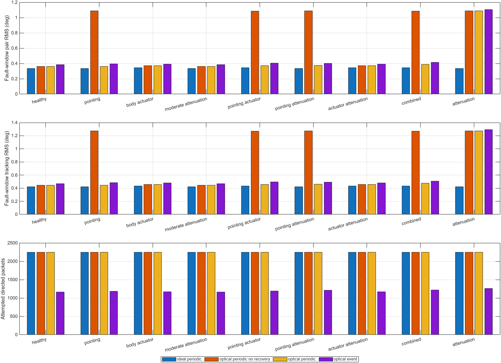

# Moving-reference coordination: measured evaluation

153 new tracking trials: 108 main comparisons (nine scenarios × four modes × three seeds) and 45 diagnosis-management ablations. Seeds are 11, 23, 47. Runs last 75 s; the fault interval is [25,60) s. All principal errors below use the fault window. These are separate from the retained static-reference benchmark and optical audit.

## Experiment and information constraints

Only SC1 reads the time-varying command. Each follower derives its target and feedforward rate from timestamped parent packets along SC1 → SC2 → SC3 → SC4 and known attitude offsets. Local hold/stabilization remains possible without packets; tracking an unknown changing leader does not. No alternative-route forwarding is implemented. Gains, fault components, topology, and seeds are matched across modes. The declared protocol and limits are in [the experiment plan](../../docs/TRACKING_EXPERIMENT_PLAN.md).

Exact quaternion-geodesic errors are used after removing the specified formation offsets. Command tracking and pair disagreement are distinct. Payload overhead counts 64 bytes per attempted directed state packet; headers, pilots, terminal electrical energy, and computation are excluded.

## 1. Does communication affect coordination?

Pointing-fault condition; means ± sample standard deviations across three channel seeds:

| Mode | Pair disagreement RMS (deg) | Tracking RMS (deg) | Torque-squared effort (N² m² s) | Attempts | Payload KiB | Affected availability |
|---|---:|---:|---:|---:|---:|---:|
| ideal_periodic | 0.3366 ± 0.0000 | 0.4217 ± 0.0000 | 7.5431e-09 | 2250.0 | 140.62 | 100.00% |
| optical_periodic_no_recovery | 1.0881 ± 0.0085 | 1.2733 ± 0.0106 | 5.3864e-09 | 2250.0 | 140.62 | 0.00% |
| optical_periodic | 0.3613 ± 0.0001 | 0.4445 ± 0.0002 | 7.7965e-09 | 2250.0 | 140.62 | 97.14% |
| optical_event | 0.3941 ± 0.0059 | 0.4823 ± 0.0071 | 9.0746e-09 | 1186.3 | 74.15 | 97.14% |

Unrecovered pointing failure changes pair RMS by +0.7515° relative to ideal transport. Recovery changes it by -0.7268° under matched periodic scheduling. Event recovery changes pair RMS by +0.0328° versus recovered periodic transport, while changing attempts by -47.27%. These are separate recovery and scheduling comparisons, not a blanket claim that one mode dominates.



The sparse command-distribution chain makes the SC1–SC2 session important to all followers. This finding establishes communication dependence for this declared task/topology, not for every redundant spacecraft network. All satellites still have local stabilization; their missing information is the moving leader command.

## 2. Diagnosis-informed communication management

The preliminary seed-11 pilot showed a measurable limitation before management policies were enabled. The recorded gate is:

```text
Unrecovered minus ideal fault pair RMS: 0.0129436309358 rad
Unrecovered minus ideal follower tracking RMS: 0.0169675846346 rad
Management study justified by measured limitation: 1
```

Management uses local observed power and accepted offset/gain estimates to assess severity and whether the available correction could restore service. Scheduling-only changes retry intervals; prediction-only changes the bounded constant-rate horizon; both combines them. Policy off remains the default. Changes below are relative to recovered event messaging with management off for the same scenario; positive error change means worse coordination.

| Scenario | Policy | Pair RMS (deg) | Pair RMS change | Attempt change | Fault-window effort change |
|---|---|---:|---:|---:|---:|
| healthy | schedule | 0.3841 | +0.00% | +0.00% | +0.00% |
| healthy | prediction | 0.3841 | +0.00% | +0.00% | +0.00% |
| healthy | both | 0.3841 | +0.00% | +0.00% | +0.00% |
| pointing | schedule | 0.4045 | +2.65% | +3.62% | +10.99% |
| pointing | prediction | 0.3886 | -1.39% | -1.07% | -3.24% |
| pointing | both | 0.3960 | +0.49% | +1.91% | +3.74% |
| pointing_actuator | schedule | 0.4204 | +3.44% | +3.41% | +19.87% |
| pointing_actuator | prediction | 0.3994 | -1.73% | -1.45% | -10.13% |
| pointing_actuator | both | 0.4086 | +0.53% | +1.31% | +2.34% |
| combined | schedule | 0.4207 | +1.29% | +1.78% | +4.87% |
| combined | prediction | 0.3998 | -3.73% | -3.15% | -21.71% |
| combined | both | 0.4018 | -3.25% | -1.32% | -17.29% |
| attenuation | schedule | 1.1055 | +0.00% | -3.99% | +0.00% |
| attenuation | prediction | 1.0947 | -0.98% | +1.77% | +23.22% |
| attenuation | both | 1.0947 | -0.98% | -2.72% | +23.22% |

These policies are heuristic and diagnosis-conditioned. Feasibility is not a guaranteed recovery-time estimate; prediction uncertainty and actuator transients are not formally bounded. Increased retry attempts can waste bandwidth during an outage. Longer constant-rate extrapolation can worsen a maneuver with changing angular rate. Every policy row is retained, including neutral or adverse outcomes.

### Diagnostic estimates behind the policy

Recovered event configuration, policy off. Fit fractions include a previously accepted estimate until mismatch validation invalidates it; conditional offset error therefore includes that detection latency. These are not fault-classification accuracy percentages.

| Scenario | Accepted-fit fraction | Conditional offset RMS (microrad) | Estimated-infeasible fraction |
|---|---:|---:|---:|
| healthy | 100.00% | 1.24 | 0.00% |
| pointing | 95.43% | 30.78 | 0.00% |
| attenuation | 95.43% | 1.24 | 94.29% |
| combined | 95.43% | 30.78 | 0.00% |

In severe attenuation, the estimated best aligned power is insufficient for most of the fault window, whereas the pointing condition is estimated feasible once identified. The separate physical recovery scores determine whether communication actually returned.

## 3. Individual and combined faults

Recovered event configuration, policy off. Factorial attenuation is gain 0.65 in every matching cell. Severe attenuation gain 0.12 is a separate control and is never substituted into an interaction calculation.

| Scenario | Pair RMS (deg) | Tracking RMS (deg) | Affected availability | Verified recovery runs | Fault saturation fraction |
|---|---:|---:|---:|---:|---:|
| healthy | 0.3841 | 0.4676 | 100.00% | no outage | 0.000% |
| pointing | 0.3941 | 0.4823 | 97.14% | 3/3 | 0.000% |
| body_actuator | 0.3929 | 0.4784 | 100.00% | no outage | 0.000% |
| moderate_attenuation | 0.3841 | 0.4676 | 100.00% | no outage | 0.000% |
| pointing_actuator | 0.4064 | 0.4962 | 97.14% | 3/3 | 0.000% |
| pointing_attenuation | 0.4001 | 0.4904 | 94.14% | 3/3 | 0.000% |
| actuator_attenuation | 0.3929 | 0.4784 | 100.00% | no outage | 0.000% |
| combined | 0.4153 | 0.5067 | 94.14% | 3/3 | 0.000% |
| attenuation | 1.1055 | 1.2946 | 0.00% | 0/3 | 0.000% |

Pair-disagreement interaction contrasts (mean ± sample SD in degrees; three paired seeds):

| Mode | P×A | P×A×T |
|---|---:|---:|
| ideal_periodic | +0.000000 ± 0.000000 | +0.000000 ± 0.000000 |
| optical_periodic_no_recovery | -0.010902 ± 0.000016 | +0.000000 ± 0.000000 |
| optical_periodic | +0.000076 ± 0.000001 | +0.003994 ± 0.000489 |
| optical_event | +0.003548 ± 0.000974 | +0.002816 ± 0.002912 |

P×A = Y(PA)−Y(P)−Y(A)+Y(healthy). P×A×T uses all eight factorial cells. These are descriptive interactions on the chosen RMS/effort/count scale. A positive error contrast indicates an increase beyond additive effects on that scale; it is not a stability proof or evidence of a unique mechanism. Three seeds do not support strong significance claims. Zero saturation means the selected actuator fault did not exercise torque saturation; it must not be described as a severe authority-limit demonstration.

## Validation and reproducibility

```text
Core checks: 11
Tracking checks: 7
Live parity interval: 32 s
Maximum aligned telemetry difference: 0
MATLAB: 26.1.0.3251617 (R2026a) Update 2
```

- The end-to-end blackout test changes the external command and confirms identical follower trajectories with zero deliveries; SC1 changes, demonstrating the absence of a hidden follower reference path.
- All 153 tracking trials have zero queue overflow and quaternion norm error below 1e-12.
- Simulink parity covers 32 s, including the optical fault onset and recovery behavior. The documented one-sample telemetry delay is aligned before comparison.
- First-seed full logs and selected figures are retained for every configuration. CSV files contain all three seeds. `run_tracking_experiments` regenerates the matrix.

## Interpretation

This extension provides experimentally measurable communication-dependent coordination and a direct, ablated connection from local diagnosis to communication policy. It does not establish that the policy improves every metric or that all combined faults are tolerated. Read the per-scenario rows and interaction traces rather than the best result alone.

The scheduler is the project’s documented event-based rule. The exact self-triggered controller from the original attitude research has not been implemented or claimed. The prior optical beam-calibration failure, ideal reciprocal pilot/sensors, normalized Gaussian optics, fixed geometry, missing acquisition protocol, and lack of formal stability/hardware validation remain limitations.

[Raw trials](all_trials.csv) · [Factorial contrasts](interactions.csv) · [Tracking model and metrics](../../docs/TRACKING_MODEL.md)
